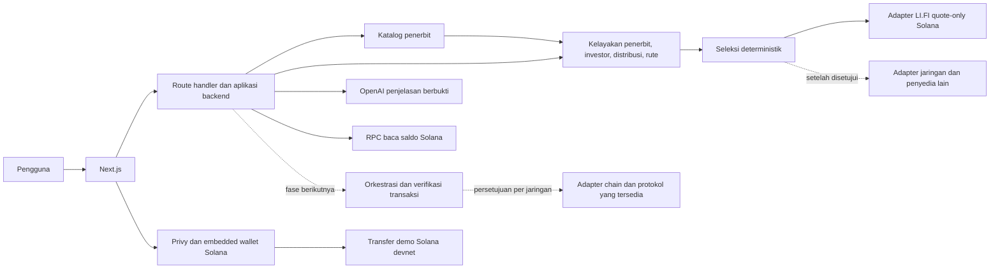
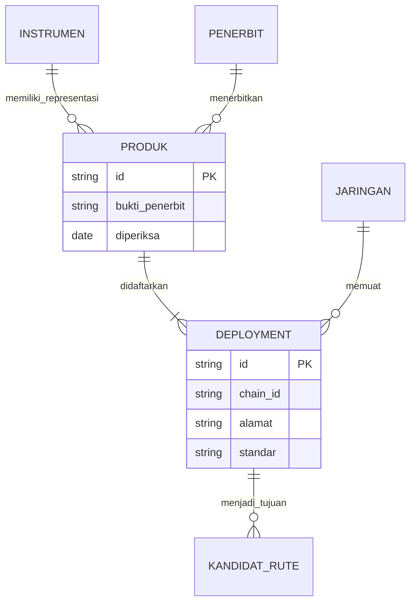
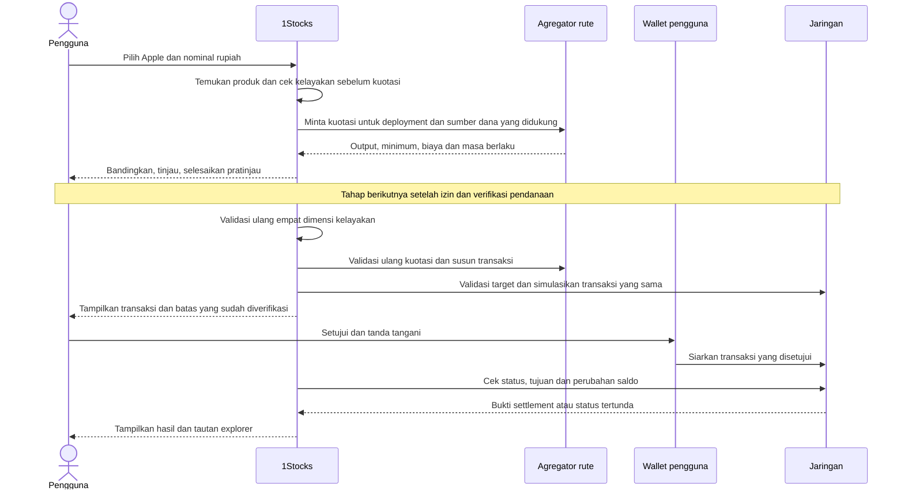
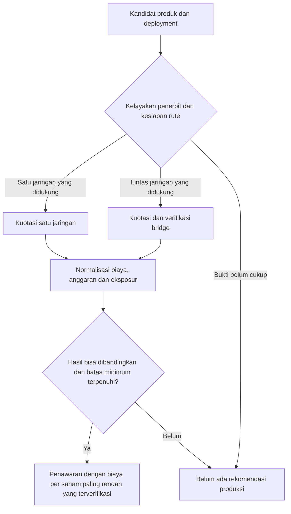
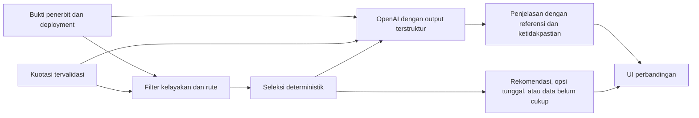

# Arsitektur agregator saham tertokenisasi

1Stocks adalah agregator saham tertokenisasi lintas penerbit dan jaringan untuk investor ritel Indonesia. Pengguna mulai dari saham dan nominal rupiah. Pilihan akhir, jika tersedia, adalah kombinasi penerbit, deployment resmi, aset pendanaan, jaringan sumber dan tujuan, serta penyedia dan rute. Solana mengisi adapter pratinjau yang tersedia saat ini. Penerbitan token produksi, DEX, pengoperasian bridge, dan protokol sintetis berada di luar lingkup.

## Alur produk

Penemuan aset → kelayakan → agregasi kuotasi lintas jaringan → peringkat deterministik dan penjelasan AI → persetujuan pengguna → eksekusi → verifikasi settlement.

- **Deployment resmi** adalah penerbitan produk tertentu pada chain dan alamat yang telah dicocokkan dengan bukti penerbit.
- **Kelayakan produksi** adalah gabungan kebijakan penerbit, kelayakan individu, persetujuan distribusi, dan kesiapan wallet serta rute. Login Google hanya membuka akses akun. Bukti yang tidak lengkap, kedaluwarsa, atau berbeda cakupan menutup jalur produksi.
- **Penawaran yang dapat dibandingkan** mempunyai bukti kelayakan, anggaran dalam satu unit, biaya all-in, serta estimasi dan minimum output untuk eksposur ekonomi setara.
- **Settlement** adalah hasil on-chain terkonfirmasi dengan saldo penerima yang sesuai, termasuk tiap tahap jika menggunakan bridge.

## Sistem saat ini dan target

Next.js menyediakan UI dan route handler. Katalog memakai snapshot sumber penerbit. Backend LI.FI memberi kuotasi Apple yang dibatasi ke Solana. Mesin seleksi membandingkan kuotasi berdasarkan aturan tetap. OpenAI menyusun penjelasan opsional berdasarkan bukti. Privy mengelola login dan embedded wallet Solana. RPC membaca saldo resmi Apple untuk alamat wallet dan saldo SOL devnet secara terpisah. Produk baru memerlukan pemeriksaan deployment serta rute masing-masing.

Katalog, peringkat, penjelasan, dan kalkulasi berlangsung off-chain. Blockchain menyimpan mint atau kontrak, saldo, tanda tangan, serta bukti settlement. Jalur demo dan baca-saja memakai program token yang sudah tersedia. App tidak memegang private key atau seed phrase pengguna.

## Katalog dan identitas

Katalog mengelompokkan produk dengan ISIN bila ada dan menggunakan identitas produk penerbit sebagai pengenal cadangan. ID deployment memakai chain kanonis dan alamat. Alamat identik di Ethereum dan BNB tetap menunjuk deployment berbeda. Deployment yang diklaim oleh dua produk berbeda pada chain yang sama ditolak. Nama produk berguna untuk tampilan dan pencarian. Identitas on-chain memakai alamat.

Sumber dan waktu verifikasi berasal dari snapshot penerbit. Detail produk membedakan kuotasi Solana dari deployment yang baru tercatat di katalog. Status penghentian penerbit dan usia snapshot membatasi klaim ketersediaan. Desimal Solana Apple berasal dari registry dan telah dicek ulang lewat RPC. Desimal EVM hanya boleh dipakai setelah diverifikasi untuk kontrak yang tepat. Katalog belum menetapkan izin geografis atau hak ekonomi pengguna. Aset operator memakai registry demo terpisah.

## Kelayakan, kuotasi, izin, dan settlement

Batasan penerbit untuk Indonesia diterapkan sebelum permintaan kuotasi. AAPLB tetap tercatat dengan sumber Binance. Status CFX dan respons agregator menjelaskan listing dan rute. Model server mengikat bukti pada yurisdiksi, penerbit, dan deployment. Bukti investor terikat identitas serta wallet. Bukti teknis terikat wallet, penyedia, aset sumber, chain tujuan, dan identitas rute. AAPLx dan AAPLon hanya memperoleh pratinjau. Sumber KYC dan otorisasi distribusi produksi belum aktif. [Bukti kelayakan dan matriks](./eligibility-evidence.md)

Respons Apple sekarang memuat input dan output atomik, minimum, biaya, provider atau router, dan kedaluwarsa. UI mencegah konfirmasi pratinjau ketika kuotasi kedaluwarsa. Identitas rute memuat penyedia serta aset dan chain sumber maupun tujuan. Pemeringkat memakai biaya all-in dalam anggaran serta unit yang sama, eksposur saham per token yang masih berlaku, minimum output, dan batas dampak harga yang disetujui. Biaya gas, perdagangan, bridge, dan konversi aset pendanaan masuk basis biaya ketika berlaku. Kesiapan teknis memerlukan pemeriksaan dampak harga dan batas risiko yang sesuai dengan rute. Adapter belum menormalisasi harga dan biaya EVM untuk aplikasi.

Tanda tangan perlu mengikuti nominal, chain, kontrak, penerima, dan batas biaya yang telah diverifikasi. Perubahan material memerlukan persetujuan baru. Untuk transaksi yang belum diketahui statusnya, simpan identitas percobaan agar status transaksi yang sama dapat diperiksa sebelum pengiriman ulang. Saat ini aplikasi dapat meminta tanda tangan untuk transfer demo devnet dengan konfigurasi operator. Pratinjau mainnet berhenti sebelum penandatanganan.

Diagram rute menggambarkan desain target. Chain yang dipakai mengikuti kualitas dan kelayakan penawaran. Jumlah kandidat dari penyedia tidak menjadi ukuran kualitas. Eksekusi Solana dan EVM dapat menggunakan antarmuka bisnis yang sama untuk penawaran dan hasil. Implementasi chain tetap memisahkan program token, allowance EVM, penandatanganan, gas, finality, dan explorer. Penambahan dompet EVM, trade EVM, dan cross-chain menunggu keputusan ADR 0002.

## AI dan seleksi

Seleksi menyaring produk yang dibatasi dan rute yang belum memenuhi syarat, lalu menilai penawaran terverifikasi tanpa preferensi chain tetap. AI menjelaskan struktur produk, hak, pembatasan, bukti rute, jaringan dan biaya yang dilaporkan. Finalitas, risiko bridge, dan likuiditas keluar tetap dinyatakan belum diketahui ketika buktinya belum tersedia. Backend memvalidasi keluaran terstruktur dan referensi yang tersedia. AI tidak menentukan nominal, mengubah kelayakan, atau mengotorisasi transaksi. Kuotasi serta seleksi tetap berfungsi ketika analisis gagal atau kredensial tidak tersedia. Endpoint model memerlukan sesi Privy yang diverifikasi. Verifikasi sesi mengonfirmasi akses akun.

## Jaringan dan bukti 28 November 2026

| Jaringan | Katalog Apple | Kuotasi tersedia di aplikasi | Eksekusi aplikasi |
| --- | --- | --- | --- |
| Solana mainnet | AAPLx dan AAPLon | LI.FI quote-only | Pratinjau |
| Ethereum mainnet | AAPLx dan AAPLon | Audit rute di luar aplikasi | Belum aktif |
| BNB Smart Chain mainnet | AAPLx, AAPLon, AAPLB | Audit rute di luar aplikasi | Belum aktif |
| Solana devnet | Registry demo terpisah | Transfer demo tanpa kuotasi DEX devnet | Transfer SPL dengan persetujuan dan konfigurasi |
| Validator lokal | Fixture operator | Pengujian terisolasi | Transfer uji |
| Jaringan snapshot lain | Katalog | Belum aktif | Belum aktif |

Dalam audit awal PR #11, permintaan LI.FI `advanced/routes` untuk 10 USDC pada chain yang sama mengembalikan HTTP 200. Ethereum memberi 3 kandidat AAPLx dan 7 AAPLon. BNB memberi 0 kandidat AAPLx, 7 AAPLon, dan 6 AAPLB. Angka itu merekam observasi historis. Pemeriksaan terbaru mengecualikan bStocks untuk Indonesia dan memisahkan rute beli, rute jual, serta percobaan simulasi. [Hasil audit lanjutan](./eligibility-evidence.md#matriks-deployment-dan-kelayakan-eksekusi) · [LI.FI API](https://docs.li.fi/api-reference/introduction) · [Alamat Ondo](https://docs.ondo.finance/addresses) · [xStocks API](https://api.xstocks.fi/api/v2/public/assets/AAPLx)

RPC publik mengonfirmasi AAPLx dan AAPLon sebagai mint Token-2022 di mainnet, dengan 8 dan 9 desimal dan extension Scaled UI Amount. Keduanya tidak ditemukan pada RPC publik devnet. Untuk rekening pemilik, adapter mempertahankan jumlah atomik dan menampilkan string saldo dari RPC per akun agar multiplier tidak dihitung melalui pembagian desimal biasa. [RPC token accounts](https://solana.com/docs/rpc/http/gettokenaccountsbyowner) · [Scaled UI Amount](https://solana.com/docs/tokens/extensions/scaled-ui-amount)

## Pendanaan dan prioritas

Nominal IDR saat ini menjadi masukan pratinjau, dengan kuotasi Solana memakai IDRX. Penyedia on-ramp, penerimaan fiat, pendanaan stablecoin, serta settlement pengguna perlu diverifikasi secara terpisah. Demo transfer membutuhkan mint yang telah diverifikasi di devnet, saldo token pengirim, SOL devnet, akun Privy, dan persetujuan. Simulasi UI dan bukti validator lokal tidak menjadi bukti transfer devnet publik.

1. Pastikan Google OAuth kembali ke aplikasi, sesi pulih, dan dompet dapat dipakai oleh akun demo.
2. Jalankan transfer devnet dengan aset demo yang tersedia dan persetujuan pengguna. Catat konfirmasi, saldo penerima, dan URL explorer.
3. Putuskan ADR, persyaratan distribusi di Indonesia, integrasi KYC, dan data kelayakan masing-masing penerbit.
4. Validasi transaksi Solana atau EVM menggunakan whitelist target, allowance atau program, data calldata atau instruksi, minimum output dan penerima. Periksa saldo sebelum dan sesudah simulasi. Uji adapter EVM di jalur terpisah sebelum aktivasi publik.
5. Evaluasi funding dan on-ramp setelah otorisasi distribusi dan alur settlement jelas.
