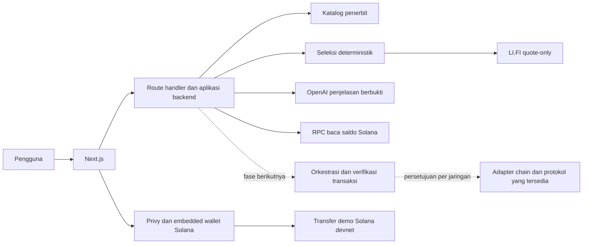
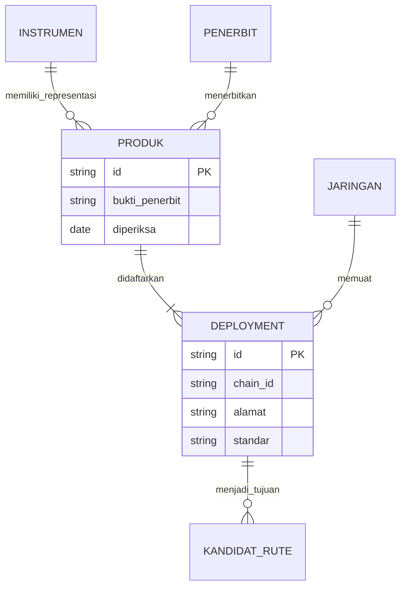
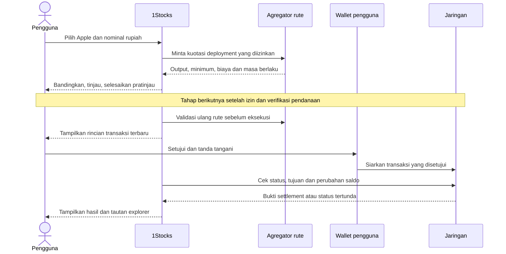
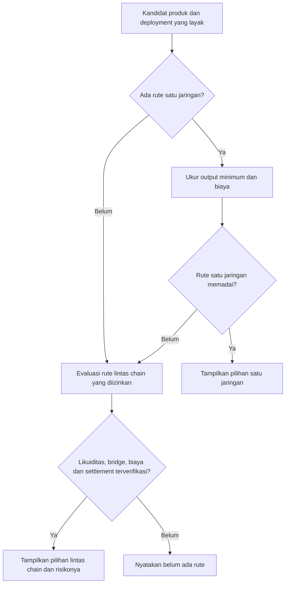
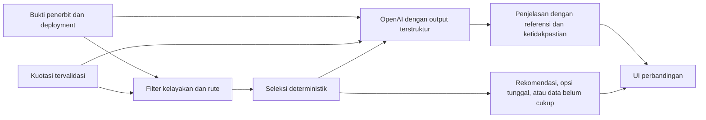

# Arsitektur agregator saham tertokenisasi

1Stocks membantu investor ritel Indonesia membandingkan produk saham tertokenisasi. Targetnya pengguna memilih saham dan nominal rupiah, lalu meninjau hasil, biaya, serta risikonya dengan detail blockchain yang dapat dibuka sesuai kebutuhan. 1Stocks mengagregasi produk penerbit dan rute penyedia. Penerbitan token produksi, DEX, pengoperasian bridge, dan protokol sintetis berada di luar lingkup.

## Sistem saat ini dan target

Next.js menyediakan UI dan route handler. Katalog memakai snapshot sumber penerbit. Backend LI.FI memberi kuotasi Apple yang dibatasi ke Solana. Mesin seleksi membandingkan kuotasi berdasarkan aturan tetap. OpenAI menyusun penjelasan opsional berdasarkan bukti. Privy mengelola login dan embedded wallet Solana. RPC membaca saldo resmi Apple untuk alamat wallet dan saldo SOL devnet secara terpisah. Produk baru memerlukan pemeriksaan deployment serta rute masing-masing.

Katalog, peringkat, penjelasan, dan kalkulasi berlangsung off-chain. Blockchain menyimpan mint atau kontrak, saldo, tanda tangan, serta bukti settlement. Jalur demo dan baca-saja memakai program token yang sudah tersedia. App tidak memegang private key atau seed phrase pengguna.

## Katalog dan identitas

Katalog mengelompokkan produk dengan ISIN bila ada dan menggunakan identitas produk penerbit sebagai pengenal cadangan. ID deployment memakai chain kanonis dan alamat. Alamat identik di Ethereum dan BNB tetap menunjuk deployment berbeda. Deployment yang diklaim oleh dua produk berbeda pada chain yang sama ditolak. Nama produk berguna untuk tampilan dan pencarian. Identitas on-chain memakai alamat.

Sumber dan waktu verifikasi berasal dari snapshot penerbit. Detail produk membedakan kuotasi Solana dari deployment yang baru tercatat di katalog. Status penghentian penerbit dan usia snapshot membatasi klaim ketersediaan. Desimal Solana Apple berasal dari registry dan telah dicek ulang lewat RPC. Desimal EVM hanya boleh dipakai setelah diverifikasi untuk kontrak yang tepat. Katalog belum menetapkan izin geografis atau hak ekonomi pengguna. Aset operator memakai registry demo terpisah.

## Kuotasi, izin, dan settlement

Respons Apple sekarang memuat input dan output atomik, minimum, biaya, provider atau router, dan kedaluwarsa. UI mencegah konfirmasi pratinjau ketika kuotasi kedaluwarsa. Model lintas chain kelak perlu membawa source dan destination chain, token dan desimal keduanya, price impact, slippage, biaya jaringan dan bridge, estimasi waktu dan izin eksekusi. Nilai yang tak diberikan penyedia perlu ditampilkan sebagai tidak diketahui.

Tanda tangan perlu mengikuti nominal, chain, kontrak, penerima, dan batas biaya yang telah diverifikasi. Perubahan material memerlukan persetujuan baru. Untuk transaksi yang belum diketahui statusnya, simpan identitas percobaan agar status transaksi yang sama dapat diperiksa sebelum pengiriman ulang. Saat ini aplikasi dapat meminta tanda tangan untuk transfer demo devnet dengan konfigurasi operator. Pratinjau mainnet berhenti sebelum penandatanganan.

Diagram rute menggambarkan desain target. Eksekusi Solana dan EVM dapat menggunakan antarmuka bisnis yang sama untuk penawaran dan hasil. Implementasi chain tetap memisahkan program token, allowance EVM, penandatanganan, gas, finality, dan explorer. Penambahan dompet EVM, trade EVM, dan cross-chain menunggu keputusan ADR 0002.

## AI dan seleksi

Seleksi menyaring rute yang tidak didukung, kuotasi kedaluwarsa, dan produk yang tidak dapat dibandingkan. AI menjelaskan bukti yang tersedia tentang struktur produk, hak, perlakuan dividen, pembatasan, dan ketidakpastian. Backend memvalidasi keluaran terstruktur dan referensi yang tersedia. AI tidak menentukan nominal, mengubah kelayakan, atau mengotorisasi transaksi. Kuotasi serta seleksi tetap berfungsi ketika analisis gagal atau kredensial tidak tersedia.

## Jaringan dan bukti 28 November 2026

| Jaringan | Katalog Apple | Kuotasi tersedia di aplikasi | Eksekusi aplikasi |
| --- | --- | --- | --- |
| Solana mainnet | AAPLx dan AAPLon | LI.FI quote-only | Pratinjau |
| Ethereum mainnet | AAPLx dan AAPLon | Audit rute di luar aplikasi | Belum aktif |
| BNB Smart Chain mainnet | AAPLx, AAPLon, AAPLB | Audit rute di luar aplikasi | Belum aktif |
| Solana devnet | Registry demo terpisah | Transfer demo tanpa kuotasi DEX devnet | Transfer SPL dengan persetujuan dan konfigurasi |
| Validator lokal | Fixture operator | Pengujian terisolasi | Transfer uji |
| Jaringan snapshot lain | Katalog | Belum aktif | Belum aktif |

Permintaan LI.FI `advanced/routes` untuk 10 USDC pada chain yang sama mengembalikan HTTP 200. Ethereum memberi 3 kandidat AAPLx dan 7 AAPLon. BNB memberi 0 kandidat AAPLx, 7 AAPLon, dan 6 AAPLB. Angka ini adalah observasi pada saat audit untuk alamat kontrak dalam snapshot. Ketersediaan dapat berubah dan belum membuktikan akses wallet, kepatuhan, atau bahwa kandidat bisa diselesaikan. [LI.FI API](https://docs.li.fi/api-reference/introduction) · [Alamat Ondo](https://docs.ondo.finance/addresses) · [xStocks API](https://api.xstocks.fi/api/v2/public/assets/AAPLx)

RPC publik mengonfirmasi AAPLx dan AAPLon sebagai mint Token-2022 di mainnet, dengan 8 dan 9 desimal dan extension Scaled UI Amount. Keduanya tidak ditemukan pada RPC publik devnet. Untuk rekening pemilik, adapter mempertahankan jumlah atomik dan menampilkan string saldo dari RPC per akun agar multiplier tidak dihitung melalui pembagian desimal biasa. [RPC token accounts](https://solana.com/docs/rpc/http/gettokenaccountsbyowner) · [Scaled UI Amount](https://solana.com/docs/tokens/extensions/scaled-ui-amount)

## Pendanaan dan prioritas

Nominal IDR saat ini menjadi masukan pratinjau, dengan kuotasi Solana memakai IDRX. Penyedia on-ramp, penerimaan fiat, pendanaan stablecoin, serta settlement pengguna perlu diverifikasi secara terpisah. Demo transfer membutuhkan mint yang telah diverifikasi di devnet, saldo token pengirim, SOL devnet, akun Privy, dan persetujuan. Simulasi UI dan bukti validator lokal tidak menjadi bukti transfer devnet publik.

1. Pastikan Google OAuth kembali ke aplikasi, sesi pulih, dan dompet dapat dipakai oleh akun demo.
2. Jalankan transfer devnet dengan aset demo yang tersedia dan persetujuan pengguna. Catat konfirmasi, saldo penerima, dan URL explorer.
3. Setujui ADR untuk uji EVM, mulai dari kuotasi yang aman sebelum wallet, gas, allowance, dan eksekusi.
4. Verifikasi ketentuan penerbit serta kepatuhan Indonesia sebelum mengaktifkan akses produksi, dan evaluasi on-ramp atau sponsorship setelah kebutuhan pendanaan jelas.
