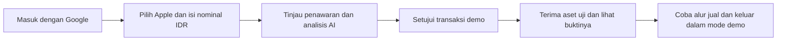

# PRD 1Stocks

Draf untuk review tim · 28 November 2026

## Tujuan produk

1Stocks membantu investor ritel mendapatkan eksposur ke saham tertokenisasi melalui satu alur yang berpusat pada saham acuan. Produk membandingkan penawaran lintas penerbit dan jaringan. Visinya melayani ritel global, dengan Indonesia sebagai pasar awal dan Apple sebagai alur MVP desktop.

Pengguna cukup memilih saham, memasukkan nominal rupiah, dan meninjau penawaran. Aplikasi menangani penemuan produk, pemilihan rute, dan kebutuhan wallet di balik layar. Penerbit, jaringan, biaya, serta risiko tetap tersedia saat pengguna meninjau hasil.

## Alur pengguna MVP

1. **Masuk dan siapkan wallet.** Pengguna masuk dengan Google melalui Privy. Aplikasi menyiapkan atau memulihkan embedded wallet. Pengguna dapat menjelajah dan melihat kuotasi sebelum login.
2. **Pilih Apple dan masukkan rupiah.** Backend meminta kuotasi LI.FI baca-saja untuk AAPLx dan AAPLon yang tersedia. Pengguna tidak perlu memilih simbol token, stablecoin, jaringan, atau gas secara manual. AAPLB tetap tampil dengan label **“Dibatasi untuk Indonesia. Informasi saja.”** Sistem mengecualikannya dari kuotasi, peringkat, dan pembelian. [Bukti kelayakan penerbit](../architecture/eligibility-evidence.md)
3. **Tinjau penawaran dan analisis.** Ringkasan menunjukkan estimasi, minimum output, biaya yang diketahui, dan masa berlaku. AI menjelaskan perbedaan penerbit, hak ekonomi seperti dividen, aset pendukung, dan risiko rute ketika tersedia bukti. Aturan server menentukan kelayakan dan peringkat. Jika biaya, pendanaan, atau eksposur belum sebanding, tampilkan alternatif dan alasan tanpa menetapkan pemenang.
4. **Otorisasi transaksi demo.** Pengguna melihat bahwa pendanaan rupiah disimulasikan dan asetnya adalah token uji. Setelah persetujuan, alur demo menyelesaikan pertukaran aset uji di testnet publik. Aplikasi menampilkan status, saldo aktual, dan tautan transaksi di explorer.
5. **Coba jual dan keluar.** Pengguna dapat menjalankan arah jual dengan aset demo. Hasil akhir menampilkan nilai rupiah simulasi dan status penyelesaian aset uji.

## Kriteria penerimaan Demo Day

| Fitur | Bukti bahwa alur berjalan |
| --- | --- |
| Katalog dan kuotasi live | Pembelian dimulai dari Apple dan nominal IDR. Backend memperoleh kuotasi dari dua penerbit yang didukung serta menangani hasil kosong atau kedaluwarsa. AAPLB terlihat dengan peringatan. |
| Analisis AI | Model live menjelaskan bukti yang dipakai. Ketiadaan data harga, likuiditas, hak, atau cadangan ditampilkan sebagai keterbatasan. Ketika AI gagal, kuotasi masih dapat ditinjau. |
| Google dan wallet | Login kembali ke aplikasi. Alamat embedded wallet tersedia dan tetap sama setelah pemulihan sesi. Logout menutup akses fitur berautentikasi. |
| Masuk dan keluar dana versi demo | Pengguna dapat memulai dari nominal rupiah simulasi dan melihat hasil jual dalam rupiah simulasi. UI memberi label demo sepanjang alur. |
| Pertukaran aset uji | Pengguna mengotorisasi arah beli dan jual. Kedua arah memiliki bukti testnet yang cocok dengan saldo aset sumber dan hasil. Transfer SPL tunggal oleh operator, simulasi, atau pratinjau hanya membuktikan tahap masing-masing. |

## Batas demo dan produksi

Kuotasi mainnet memakai akses baca-saja. Pertukaran demo memakai aset uji yang terpisah dari token saham resmi. Setoran dan penarikan rupiah nyata, eksekusi mainnet, dan akses produksi menunggu izin distribusi, kelayakan pengguna, pendanaan, dan rute yang terverifikasi. 1Stocks tidak menerbitkan token saham produksi atau membangun DEX dan bridge sendiri.

Target ini belum terpenuhi seluruhnya. Laporan yang tersedia mencatat kuotasi LI.FI, analisis OpenAI live, dan transfer devnet oleh operator. Login Google hingga pemulihan wallet serta pertukaran aset uji dua arah yang diotorisasi pengguna masih perlu dibuktikan. [Bukti verifikasi yang dilaporkan](https://github.com/1Stocks/1stocks/blob/6482457ecb0ee19c9a490475e9584bc51b6e61b2/docs/architecture/apple-mvp-verification.md)
