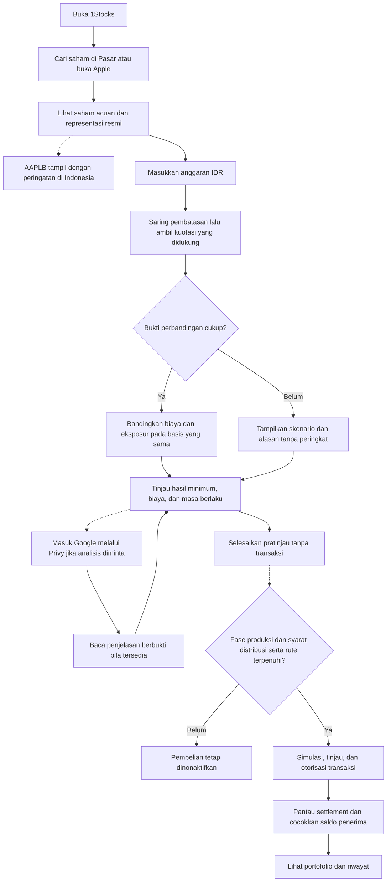

# PRD 1Stocks

Draf v0.2 untuk tinjauan tim · 28 November 2026 · Pemilik dokumen menunggu penetapan tim. Dokumen ini menjadi pintu masuk untuk tujuan produk, alur pengguna, dan batas tiap fase.

## Visi dan pengguna

1Stocks adalah agregator saham tertokenisasi lintas penerbit dan jaringan, dengan analisis berbantuan AI, untuk investor ritel di berbagai negara. Indonesia adalah pasar awal. Aplikasi dimulai dari saham acuan dan nominal investasi dalam IDR. Tim menilai pembukaan pasar berikutnya per yurisdiksi, kanal distribusi, dan syarat penerbit.

Investor ritel dapat menemukan beberapa representasi dari saham acuan yang sama. Perbedaan penerbit, hak pemegang, biaya, pendanaan, batas geografis, dan rute dapat membuat harga atau jumlah token sulit dibandingkan. Pengalaman yang dituju membantu pengguna memahami bukti tersebut sebelum mengambil keputusan. Saat izin dan infrastruktur mendukung, pengguna dapat mengotorisasi transaksi sendiri.

| Profil pengguna yang diusulkan | Kebutuhan |
| --- | --- |
| Investor ritel dengan anggaran rupiah | Memahami produk apa yang bisa ditinjau dan apa yang diperoleh pada nominal tertentu. |
| Investor yang sudah punya aset digital | Menilai biaya masuk, hasil minimum, sumber dana, risiko rute, dan opsi keluar. |
| Tim demo dan operasional | Menunjukkan bukti kuotasi, analisis, simulasi, atau settlement sesuai lingkungan yang benar. |

Pintu sudah menawarkan AAPLX di Indonesia. Hipotesis diferensiasi 1Stocks adalah perbandingan lintas penerbit untuk satu saham, dengan dasar perbandingan yang dapat diperiksa dan penjelasan tentang kapan perbandingan belum dapat dilakukan. Bukti permintaan pengguna, manfaat AI, dan kesiapan distribusi masih harus dikumpulkan. [Riset pasar](../research/MARKET-RESEARCH.md)

## Alur pengguna menyeluruh

| Tahap | Hasil bagi pengguna | Cakupan dan kondisi penting |
| --- | --- | --- |
| 1. Masuk atau lanjut sebagai tamu | Pengguna dapat menjelajah dan meninjau kuotasi tanpa sesi. Login Google melalui Privy membuka analisis berautentikasi serta akses wallet. | Alur tamu tersedia. Untuk akun aktif, pulihkan sesi dan embedded wallet Solana, tampilkan alamat, serta sediakan logout. Verifikasi sesi Google hingga pemulihan wallet masih diperlukan. |
| 2. Temukan saham dan produk | Pengguna mencari saham acuan dan membuka detail penerbit dan deployment. | Apple adalah alur kuotasi awal. Aset lain dapat tampil sebagai katalog. AAPLB diberi peringatan Indonesia dan dikeluarkan sebelum kuotasi, peringkat, atau pembelian. |
| 3. Masukkan anggaran IDR | Pengguna melihat nominal yang dimasukkan dan basis pendanaan kuotasi. | Nominal adalah konteks pratinjau. Aset pendanaan, jaringan, dan asumsi saldo terlihat sebagai detail. Pendanaan fiat dan penarikan rupiah menunggu jalur yang disetujui. |
| 4. Bandingkan penawaran | Pengguna melihat minimum output yang dilaporkan penyedia, biaya yang dilaporkan, dan masa berlaku. | Normalisasi eksposur, kurs, dan biaya sebelum memberi peringkat. Kondisi dana yang berbeda tampil terpisah. Jika kuotasi hilang atau kedaluwarsa, minta penyegaran. |
| 5. Baca analisis bila tersedia | Pengguna memahami perbedaan produk dan rute serta alasan sistem menahan penilaian. | OpenAI menjelaskan bukti. Aturan kelayakan, hitungan, dan peringkat di server tetap deterministik. Ketika AI gagal atau login dibatalkan, kuotasi tetap tersedia sesuai konfigurasi dan kondisi layanan. |
| 6. Tinjau dan selesaikan pratinjau | Pengguna melihat ringkasan penerbit, estimasi, minimum, biaya yang diketahui, dan batas status. | Jalur Demo Day berakhir di sini. Simulasi mainnet baca-saja dan transfer SPL devnet disajikan sebagai bukti teknis terpisah. |
| 7. Otorisasi transaksi | Pengguna yang memenuhi syarat menyetujui transaksi spesifik dengan penerima dan batas yang jelas. | Target produksi. Validasi izin, pendanaan, wallet, kuotasi, route dan simulasi. Perubahan material memerlukan persetujuan baru. Jika saldo kurang, izin belum cukup, atau simulasi gagal, tahan pengiriman. |
| 8. Verifikasi hasil | Pengguna melihat status terkonfirmasi, saldo, bukti explorer, dan riwayat. | Target produksi. Simpan identitas transaksi untuk status tertunda. Periksa transaksi yang sama sebelum pengiriman ulang. Pisahkan saldo mainnet dari devnet. |

Detail lingkungan, bukti, dan prioritas ada di [cakupan MVP](MVP-SCOPE.md). Persyaratan di bawah menjadi acuan saat tim siap memecah pekerjaan.

## Persyaratan produk

Tabel ini mencatat persyaratan yang diusulkan sebagai acuan review. [Cakupan MVP](MVP-SCOPE.md) dan [matriks penerimaan](../quality/ACCEPTANCE-CRITERIA.md) mencatat batas demo dan bukti masing-masing.

| ID | Persyaratan |
| --- | --- |
| FR-001 | Pengguna mencari saham acuan dan melihat detail serta representasi resminya. |
| FR-002 | Pengguna memasukkan anggaran IDR dan meninjau kuotasi Apple yang tersedia, termasuk hasil minimum, waktu kedaluwarsa, dan keterbatasan perbandingan. |
| FR-003 | Sistem membandingkan deployment lintas jaringan bila sumber dana, biaya dan eksposur dapat dinormalisasi. Skenario dengan asumsi berbeda tampil terpisah. |
| FR-004 | Pengguna dapat masuk, keluar, memulihkan sesi, dan melihat alamat wallet. Saldo diberi label jaringan dan lingkungan. |
| FR-005 | Pengguna dapat meninjau aktivitas dan portofolio berdasarkan transaksi serta saldo yang terverifikasi. |
| AI-001 | Penjelasan AI merujuk bukti yang tersedia, melaporkan ketidakpastian, dan menjelaskan perbedaan produk, pendanaan, jaringan, serta rute tanpa menetapkan peringkat. |
| BC-001 | Aset produksi diidentifikasi berdasarkan penerbit, jaringan, alamat deployment, dan bukti resmi. |
| BC-002 | Transaksi hanya dapat disiapkan dan diotorisasi pada kondisi yang diizinkan, dengan pengungkapan biaya dan pemeriksaan rute. Status akhir mengikuti bukti jaringan. |
| CMP-001 | Status yurisdiksi, kelayakan pengguna, izin kanal distribusi, dan kesiapan teknis tervalidasi sebelum transaksi. Bukti yang hilang atau kedaluwarsa menahan produksi. |
| CMP-002 | AAPLB tampil sebagai informasi dengan peringatan untuk Indonesia. Produk dibatasi tidak masuk kuotasi, peringkat, atau transaksi untuk pengguna tersebut. |
| NFR-001 | Kalkulasi menggunakan unit atomik dan aritmetika eksak. Eksposur saham mengikuti desimal dan rasio yang terverifikasi per deployment. |
| NFR-002 | Gangguan provider, RPC, sesi, atau AI memberi status yang dapat dipahami. API sensitif tetap di server dan private key pengguna dikelola wallet. |

## Batas produk

Apple adalah alur demo pertama. Cakupan global tidak memberi akses otomatis di seluruh negara. Aset resmi berasal dari penerbit yang terverifikasi. 1Stocks berada di luar lingkup penerbitan token produksi, DEX, bridge, atau blockchain sendiri. Token demo terisolasi untuk membuktikan perilaku teknis tanpa eksposur saham. Pendanaan demo di halaman Apple memakai nominal IDR sebagai konteks kuotasi. Setoran fiat menunggu jalur pendanaan dan pembagian tanggung jawab yang disetujui.

## Ukuran keberhasilan dan keputusan terbuka

Ukur kemampuan pengguna menuntaskan pratinjau, memahami minimum output serta biaya, membedakan pratinjau dan pembelian, dan memahami alasan sistem menahan rekomendasi. Ukur cakupan bukti kuotasi dan jumlah skenario yang tidak bisa dibandingkan untuk menemukan hambatan data. Target angka menunggu data dan persetujuan tim.

Tim masih perlu memilih jalur kerja sama distribusi di Indonesia, cakupan KYC, kelayakan pendanaan IDR, kesiapan transfer berbasis Privy, dan keputusan atas ADR 0002. Satu negara dibuka setelah pemeriksaan hukum, mitra, kemampuan teknis, dan kebijakan penerbit untuk negara itu selesai. [Batas kelayakan](../architecture/eligibility-evidence.md)
