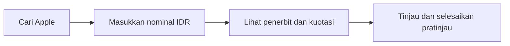

# PRD 1Stocks

Draf untuk review tim · 28 November 2026

## Tujuan produk

1Stocks membantu investor ritel membandingkan representasi saham tertokenisasi dari beberapa penerbit dan jaringan. Indonesia menjadi pasar awal, dengan nominal investasi dalam rupiah. Produk ditujukan untuk ritel di berbagai negara, dengan akses yang ditentukan per yurisdiksi.

Pengguna ingin tahu pilihan yang tersedia untuk mendapatkan eksposur ke saham Apple dengan anggaran tertentu. 1Stocks menunjukkan penerbit, hak pemegang yang dapat diverifikasi, biaya yang diketahui, estimasi hasil, dan pembatasan tiap pilihan. Analisis AI membantu menjelaskan perbedaan berdasarkan bukti yang tersedia.

## Alur MVP

1. **Cari Apple.** Pengguna membuka Pasar atau halaman Apple dan melihat produk dari xStocks, Ondo, dan bStocks. AAPLB tampil dengan peringatan **“Dibatasi untuk Indonesia. Informasi saja.”** Kuotasi, peringkat, dan pembelian AAPLB dikecualikan untuk pengguna Indonesia. [Bukti kelayakan penerbit](../architecture/eligibility-evidence.md)
2. **Masukkan nominal IDR.** Aplikasi mempertahankan nominal pengguna sebagai dasar pratinjau. Kuotasi baca-saja yang didukung saat ini berasal dari LI.FI untuk AAPLx dan AAPLon di Solana.
3. **Bandingkan penawaran.** Tampilkan estimasi, minimum output, biaya yang tersedia, masa berlaku, dan kondisi pendanaan. Beri peringkat hanya jika sumber dana, biaya, dan eksposur saham dapat dibandingkan. Jika bukti kurang, tampilkan skenario secara terpisah beserta alasannya.
4. **Tinjau dan selesaikan pratinjau.** Pengguna dapat mengikuti alur sebagai tamu. Analisis opsional menggunakan sesi Google melalui Privy jika konfigurasi tersedia. Penjelasan AI merujuk bukti, sedangkan kelayakan, kalkulasi, dan peringkat ditentukan aturan aplikasi. Hasil akhirnya adalah ringkasan pratinjau tanpa tanda tangan atau transaksi.

## Batas Demo Day dan produk selanjutnya

- **Demo Day.** Tunjukkan alur Apple sampai pratinjau. Kuotasi lintas jaringan yang tersedia di lingkungan uji tetap berlabel indikatif. Transfer SPL devnet dapat didemokan terpisah sebagai transfer aset uji. Alur login Google sampai pemulihan wallet perlu diverifikasi dengan akun demo.
- **Produksi.** Setelah izin distribusi, syarat penerbit, kelayakan pengguna, pendanaan, dan kesiapan rute terbukti, pengguna dapat meninjau transaksi, mengotorisasinya, lalu melihat status penyelesaian, saldo, dan riwayat. Pembelian produksi dan setoran rupiah tetap nonaktif selama prasyaratnya belum terpenuhi.
- **Batas produk.** 1Stocks mengagregasi produk dari penerbit yang terverifikasi. Penerbitan token saham, DEX, dan bridge milik 1Stocks berada di luar cakupan.

## Kriteria penerimaan MVP

- Pengguna dapat menemukan Apple, memasukkan nominal IDR, dan meninjau kuotasi AAPLx serta AAPLon ketika tersedia.
- AAPLB tetap terlihat dengan peringatan dan tidak dapat dipilih untuk kuotasi, peringkat, atau pembelian di Indonesia.
- Kuotasi kosong atau kedaluwarsa menampilkan alasan dan pilihan penyegaran. Data yang belum sebanding tidak menghasilkan pemenang.
- Pengguna dapat menyelesaikan pratinjau ketika AI atau login tidak tersedia. Halaman hasil menjelaskan bahwa belum ada transaksi.

## Keputusan untuk review tim

1. Sepakati bahwa hasil Demo Day adalah pratinjau Apple. Verifikasi wallet dan transfer devnet punya bukti terpisah.
2. Tentukan jalur distribusi dan pendanaan IDR yang perlu divalidasi sebelum mendesain pembelian produksi.
3. Putuskan kapan perbandingan lintas jaringan layak dibuka ke pengguna berdasarkan [usulan ADR 0002](../adr/0002-seleksi-produk-lintas-jaringan.md).
