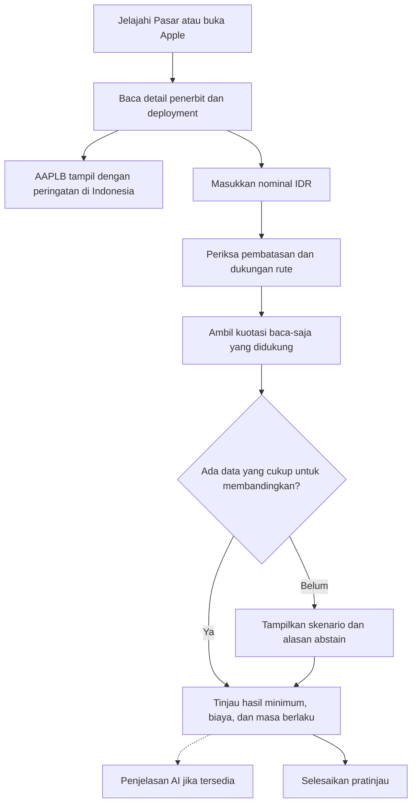
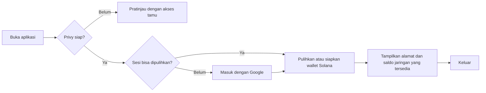
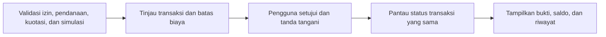

# Alur pengguna 1Stocks

Status mengacu pada [cakupan MVP](MVP-SCOPE.md). Diagram memisahkan pratinjau Apple dari jalur transaksi yang direncanakan.

## Penemuan dan pratinjau Apple

Pencarian mencakup saham yang tercatat di katalog. Jalur pembelian Apple berakhir pada pratinjau. Saat mode multichain internal aktif, dasar pendanaan, jaringan, dan asumsi wallet terlihat untuk setiap skenario. Pekerjaan verifikasi finansial mengikuti **FR-002**, **FR-003**, **CMP-001**, **CMP-002**, dan **NFR-001**.

## Akun dan wallet

Konfigurasi dan alur sesi tersedia. Pemulihan lengkap memakai akun Google asli memerlukan verifikasi terpisah. Saldo Apple resmi dan SOL devnet ditampilkan secara terpisah. Jika OAuth dibatalkan, server tidak dapat mengakses AI berautentikasi. Jika wallet atau RPC gagal, tampilkan statusnya dan pertahankan bagian aplikasi yang tersedia. **FR-004**, **NFR-002**.

## Persetujuan, settlement, dan riwayat

Diagram ini adalah rancangan transaksi produksi. Keempat bukti kelayakan harus berlaku untuk rute yang sama. Persetujuan menjadi tidak berlaku saat penerima, jaringan, hasil minimum, nominal, atau batas biaya berubah. Transfer devnet memiliki jalur dan aset uji terpisah. **BC-002**, **FR-005**.

| Keadaan | Perilaku yang diharapkan |
| --- | --- |
| Aset tidak didukung | Tampilkan detail katalog bila tersedia. Tutup tindakan pembelian. |
| Pembatasan penerbit | Tampilkan produk dan alasan pembatasan. Keluarkan produk dari penawaran yang bisa dipilih. |
| Kuotasi kosong atau kedaluwarsa | Jelaskan kondisi. Hentikan konfirmasi kedaluwarsa dan tawarkan penyegaran. |
| Wallet hilang atau saldo tidak cukup | Pratinjau tetap dapat tersedia. Tahan jalur transaksi serta jelaskan kebutuhan dana atau gas. |
| Biaya atau eksposur belum lengkap | Tampilkan nilai yang terbukti dan status indikatif. Tahan peringkat. |
| AI tidak tersedia | Pertahankan kuotasi dan penjelasan aturan yang sudah tersedia. |
| Simulasi atau transaksi gagal | Tahan pengiriman bila simulasi gagal. Bila sudah dikirim, periksa hasil yang sama dan tampilkan kegagalan terverifikasi. |
| Settlement tertunda atau tidak diketahui | Simpan identitas percobaan. Periksa status serta saldo sebelum menawarkan percobaan baru. |
